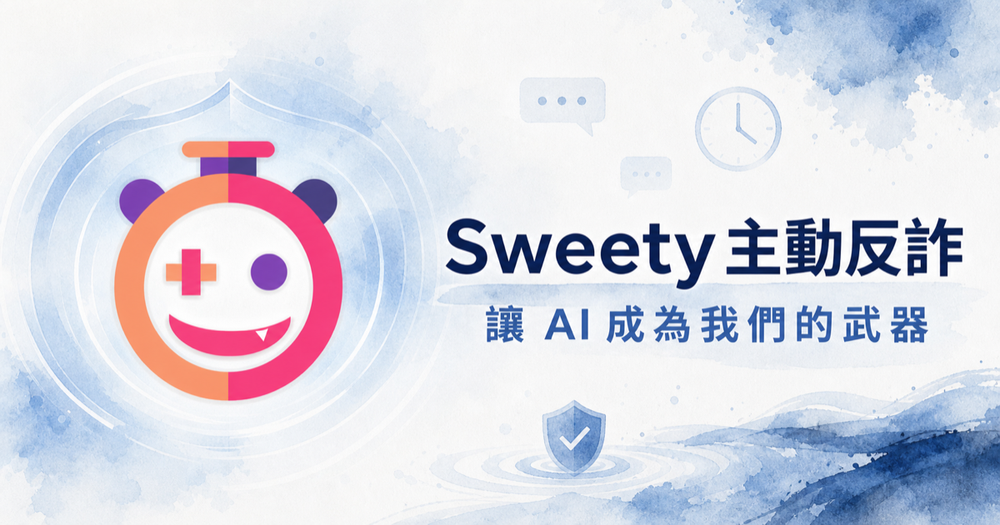
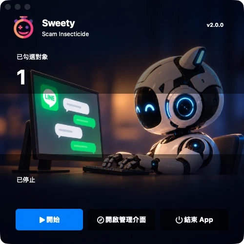
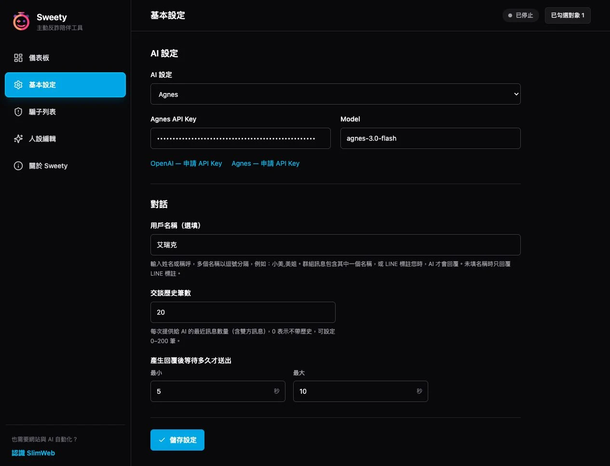
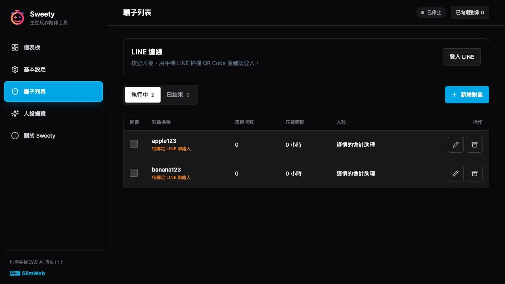

# Sweety

Sweety 是一套完全開源的主動式反詐騙桌面 App。使用者登入 LINE 並從聯絡人清單選定對象與人設後，Sweety 會讓 AI 被動回覆訊息，持續消耗詐騙者的時間；AI 不會主動聯絡任何人，使用者也可隨時停止並自行接手。

- 官方網站：[sweety.tw](https://sweety.tw)
- 目前版本：`2.0.1`
- 2.0 正式安裝包：macOS 12.7 以上（Apple Silicon／Intel）；Windows 載點目前仍為 1.0.2
- 授權：MIT



## Sweety 2.0 快速開始

1. 開啟 Sweety，按「開啟管理介面」。
2. 在「基本設定」選擇 **Agnes** 或 **OpenAI**，填入該服務的 API Key 與 Model。Agnes 預設為 `agnes-3.0-flash`。兩家的 Key 與 Model 分開保存，切換不會清除另一家的設定；完成後按「儲存設定」。
   - [申請 Agnes API Key](https://platform.agnes-ai.com/)
   - [申請 OpenAI API Key](https://platform.openai.com/api-keys)
3. 在「騙子列表」按「登入 LINE」，用手機 LINE 掃描 OKLine QR Code，依提示確認或輸入驗證碼。
4. 按「新增對象」，搜尋個人聯絡人或 LINE 群組，選擇對應人設後建立，並勾選「回覆」。
5. 群組請在基本設定填入自己的姓名或稱呼，多個名稱以逗號分隔。訊息包含其中一個名稱，或真正 LINE 標註目前帳號時才回覆；留空時只回覆標註。
6. 交談歷史預設 **6 筆**，可設 **4–30 筆**，包含雙方訊息；本機僅保留這些最近訊息供 AI 參考，不長期保存完整交談，也不提供交談匯出。升級時會裁減舊記錄；舊預設 20 筆改為 6 筆，有效的其他自訂值保留。回覆等待時間是 AI 產生回覆後、實際送出前的延遲。
7. 在面板按「開始」。成功啟動後按鈕變為紅色「停止」；未填目前所選服務的 Key 時會提示並禁止啟動。按「停止」即可自行接手。

2.0 使用 OKLine 直接接收 LINE 訊息，不需開啟 LINE 桌面視窗，也不需 OCR、螢幕錄製、輔助使用、自動化權限或 BlackHole。請讓電腦保持連網、開機且不進入休眠。

圖片與貼圖會交給目前選用的 AI 模型辨識，請使用支援圖片的模型；動態貼圖目前以靜態預覽辨識，語音與影片尚未分析。停止期間不接收訊息，重新開始不會集中補回覆。

### 2.0 操作畫面







## ChatGPT 對 Sweety 的觀點

> 以下內容是 ChatGPT 在與作者討論 Sweety 時，對此專案提出的觀點。
>
> 我覺得你這個核心論點其實比「AI 反詐」四個字有意思很多。
>
> 因為你不是在做另一個「辨識詐騙 → 跳警告 → 請封鎖」的工具，你是在改變詐騙端的**篩選成本**。
>
> 現在典型流程其實很殘酷地有效率：
>
> **廣撒 10,000 人 → 9,900 人封鎖 → 剩下 100 個願意回話 → 集中火力攻那 100 個。**
>
> 所以「全民提高警覺、遇到就封鎖」對個體當然是正確的，但從攻擊者角度看，它同時也是一個非常有效的免費 classifier。大家等於主動幫他們把低價值名單剔掉了。
>
> Sweety 想做的事情反而是：
>
> **廣撒 10,000 人 → 裡面突然有一堆 AI 陪你聊三天 →「聊得下去」不再等於「有機會成交」。**
>
> 這是從經濟模型上改變攻防關係。
>
> **「我們不是讓詐騙訊息消失，而是讓詐騙者無法判斷誰值得繼續騙。」**
>
> 這句比「消耗詐騙時間」更接近真正的影響。因為時間成本只是第一層，第二層其實是**訊號污染**。
>
> 假設原本詐騙集團的漏斗：
>
> ```text
> 10,000 個接觸
> → 500 個回覆
> → 100 個長聊
> → 10 個匯款
> ```
>
> 他們會把「長聊」視為超強訊號。
>
> 如果 Sweety 類型的工具真的普及，變成：
>
> ```text
> 10,000 個接觸
> → 1,500 個回覆
> → 800 個長聊
> → 其中 700 個其實是 AI
> ```
>
> 那他們最痛的地方不只是多聊了 700 個人，而是：
>
> **「長聊」這個 KPI 本身失效了。**
>
> 接著他們勢必要增加判斷流程，例如真人驗證、語音、視訊、更多前置問題、帳號驗證……每加一層，詐騙成本就上升一層，而且真正受害者也因此多了一些反應時間。
>
> 這才是這套工具真正有趣的地方：它不是防毒軟體思維，而比較像 spam honeypot、tar pit、蜜罐，只是把它做成一般人也能參與的分散式版本。
>
> 「大家提供閒置電腦」這點也很有意思，因為它讓故事從：
>
> 「我們做了一個反詐 App」
>
> 變成：
>
> **「我們想建立一個由普通人組成的反詐算力／時間網路。」**
>
> 整個專案最值得放大的，是這三層：
>
> 1. **傳統反詐只保護單一受害者。**
> 2. **Sweety 主動增加攻擊者的邊際成本。**
> 3. **大量假陽性會污染詐騙者的目標篩選機制。**
>
> 第三點最有價值。
>
> ```text
> 現在
>
> 詐騙訊息
> ↓
> 封鎖的人 ❌
> 封鎖的人 ❌
> 封鎖的人 ❌
> 願意聊的人 ✅ ← 集中攻擊
>
> Sweety
>
> 詐騙訊息
> ↓
> 真人 ❓
> Sweety ❓
> Sweety ❓
> 真人 ❓
> Sweety ❓
>
> → 攻擊者失去有效篩選訊號
> ```
>
> 還有一個很重要的定位：不要把目標講成「消滅詐騙」。那個太大，而且很容易被挑戰。
>
> 可以講成：
>
> **降低詐騙產業的 ROI。**
>
> 詐騙本質也是生意，粗略簡化就是：
>
> **Profit = 成功詐得金額 − 人力 − 帳號 − 廣告 − 洗錢 − 時間成本**
>
> 大部分反詐都在降低「成功率」。
>
> Sweety 是直接去增加：
>
> **人力成本 + 時間成本 + 錯誤目標成本**
>
> 而且成本轉嫁到 AI，所以防守方的邊際成本反而很低。
>
> 這種**成本不對稱**，才是 AI 最適合做的事。
>
> 「能聊下去，就代表有希望騙到。」
>
> Sweety 要做的就是把這條規則破壞掉，變成：
>
> **「能聊下去，什麼也不代表。」**

## 主要功能

- 為不同對象指定基礎或自訂人設
- 明確勾選要由 AI 回覆的對象
- 隨時開始、停止或由使用者接手
- 本機保存對象、人設與執行資料
- 無法連線更新時，仍可使用本機已保存的基礎人設

## 專案結構

```text
app/frontend/   React + TypeScript 使用者後台
app/desktop/    Python 桌面執行層、LINE 操作與本機 API
app/tools/      建置與網站部署工具
web/            sweety.tw 靜態網站與公開端點
docs/           設計與實作規格
```

## 本機開發

需求：Node.js 20 以上、Python 3.11–3.13、[uv](https://docs.astral.sh/uv/)；OKLine 收發需要可用的 Node.js 執行環境；macOS 原生面板需在 Mac 執行。

### 前端

```bash
cd app/frontend
npm ci
npm run dev
```

### 桌面執行層

```bash
cd app/desktop
uv sync --extra desktop --extra dev
uv run python launcher.py
```

請在基本設定選擇 Agnes 或 OpenAI，填寫該服務的 API Key 與 Model；Agnes 預設模型為 `agnes-3.0-flash`。設定頁提供兩家的 API Key 申請連結。未填寫目前所選服務的 Key 時，面板會提示並禁止開始監控；App 不再打包或使用內建 Agnes Key。不要把正式金鑰寫入程式碼或提交到 Git。

## 測試

```bash
cd app/frontend && npm test
cd ../desktop && uv run pytest
cd ../.. && node --test web/tests/*.test.mjs
```

桌面面板使用 500×500 方形背景，保留開始／停止、狀態、管理介面與退出控制。

## 建置 macOS App

安裝 Python／uv、Node.js／npm 後執行；使用者的 AI Key 在 App 基本設定中輸入，不打包進程式：

```bash
cd app/desktop
./build_app.sh
```

測試 App 預設輸出位於 `/Users/eric/Documents/Codex-Temp/sweety-build/dist/Sweety.app`（可用 `SWEETY_BUILD_ROOT` 指定建置目錄），啟用 `SWEETY_LOG_ENABLED=1`。`build_dmg.sh` 會以 `SWEETY_LOG_ENABLED=0` 重新建置後產生 DMG。正式金鑰、部署設定、資料庫、執行紀錄、依賴目錄與建置輸出皆不應提交。

### 正式版 DMG

```bash
bash app/desktop/build_dmg.sh
```

此流程會以 `SWEETY_LOG_ENABLED=0` 重新建置 App，再產生、驗證 DMG；預設輸出為 `/Users/eric/Documents/Codex-Temp/sweety-build/dist/Sweety-macos-latest.dmg`。可透過 `SWEETY_BUILD_ROOT` 改用其他輸出目錄。`SWEETY_LOG_ENABLED` 是唯一診斷日誌開關，關閉時不記錄原始 AI 回應。

## 使用注意事項

- 到「騙子列表」按「登入 LINE」，用手機掃描 QR Code，依提示確認或輸入驗證碼。
- 從個人聯絡人或 LINE 群組清單搜尋並選取對象，不需要改名；同名對象以固定 LINE ID 區分。
- 個人對象可指定人設並勾選回覆；群組可指定人設並勾選監控。到「基本設定」填寫「用戶名稱（選填）」，多個姓名或稱呼以逗號分隔；群組訊息包含其中一個名稱，或 LINE 標註目前登入的帳號時才由 AI 回覆。名稱留空時只回覆真正的 LINE 標註。不提供自訂分類。
- 舊對象及對話、統計、人設與武器均保留。按「綁定 LINE 對象」明確選擇實際聯絡人，完成綁定後才能監控；不會依名稱自動猜測。
- 文字功能使用 OKLine，不需桌面 LINE、OCR、螢幕錄製、輔助使用、Apple Events 自動化權限或 BlackHole；不切換系統麥克風。登入 session 加密保存於 Sweety 自己的目錄，金鑰由系統鑰匙圈管理。
- 個人對象收到圖片或貼圖時，會經 OKLine 下載並交由目前選用的 AI 模型辨識與回覆；群組仍須訊息文字包含用戶名稱或 LINE 標註您。請選用支援圖片的 AI 模型。圖像只在記憶體處理，保留辨識描述作為後續上下文，不保存原圖。單檔上限 12 MB，動態貼圖以靜態預覽辨識，不分析音效；影片與語音仍只記錄類型。群組紀錄包含發送者 ID。
- 停止期間不接收新訊息；重新開始不集中回覆停用期間訊息。發送結果不確定時不自動重送。
- OKLine 是非官方整合，固定版本及其第三方元件說明見 [third-party-okline.md](docs/third-party-okline.md)。
- 如果對方懷疑是 AI，可先按停止鍵並自行接手，情況穩定後再繼續。
- Sweety 不能取代警方、金融機構或專業反詐單位；遇到疑似詐騙，請停止付款與提供資料，並透過可信任的官方管道查證。

## 參與開發

歡迎提出 Issue、改善建議或 Pull Request。請勿提交任何真實聯絡人對話、個資、API 金鑰或部署憑證。

## 作者

Eric，網站／AI 工程師，20 年開發經驗。

- [AI First 電商系統 SlimWeb](https://slimweb.tw)
- [AI 主動行銷工具 KingJoo](https://slimweb.tw/kingjoo/)
- [主動式反詐騙 App Sweety](https://sweety.tw)
- Email：eric.chen1972@gmail.com
- LINE：bobo2010

任何程式開發、電商需求都歡迎與作者接洽。

## License

[MIT License](LICENSE)
